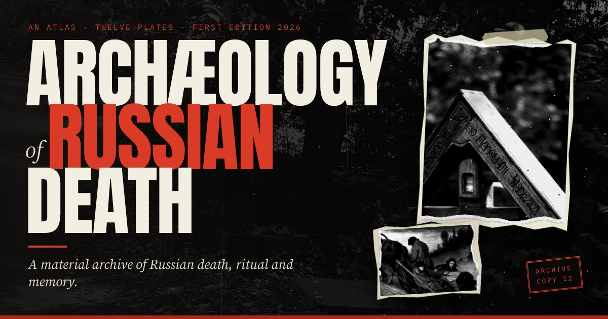
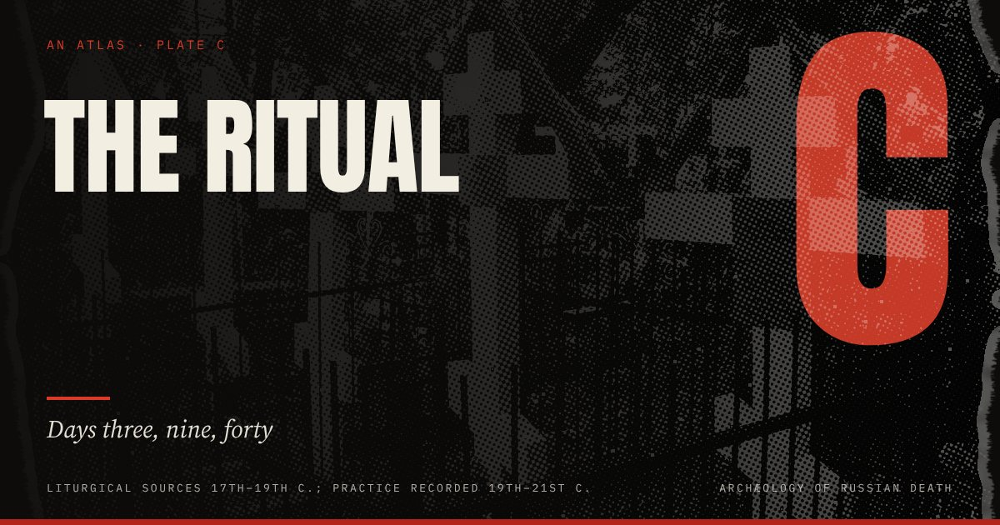
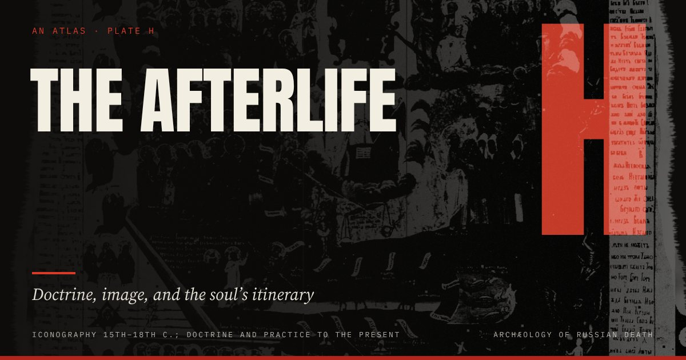
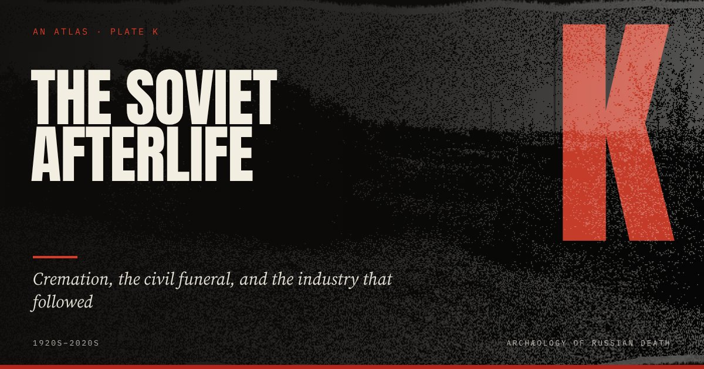
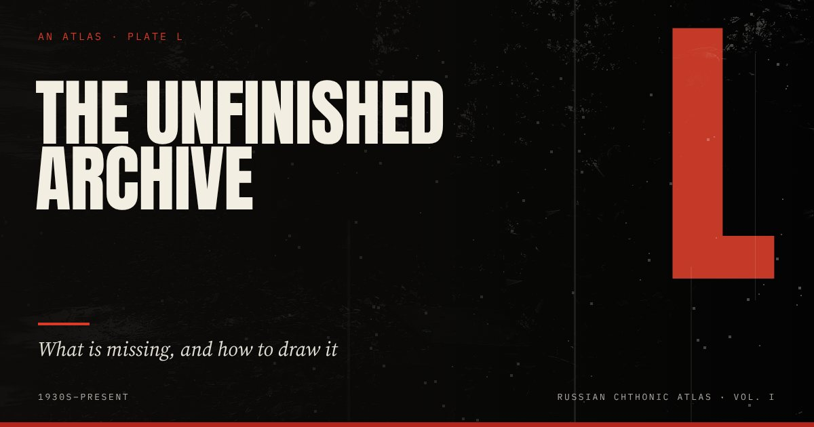
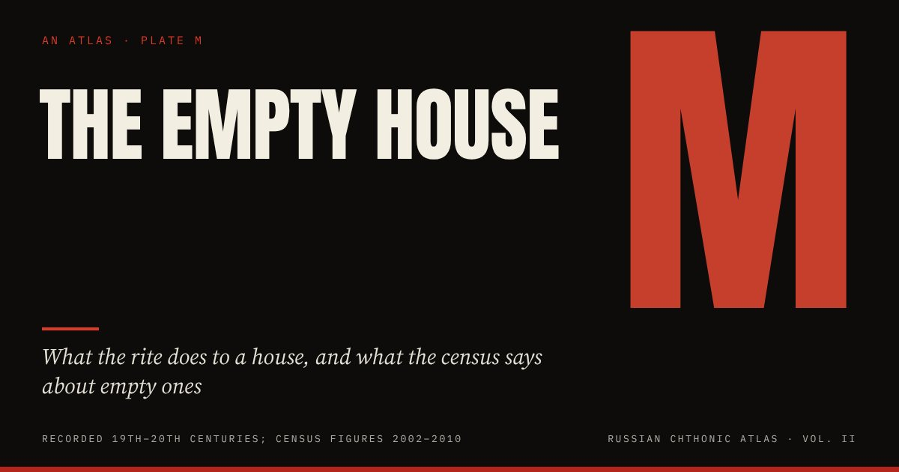
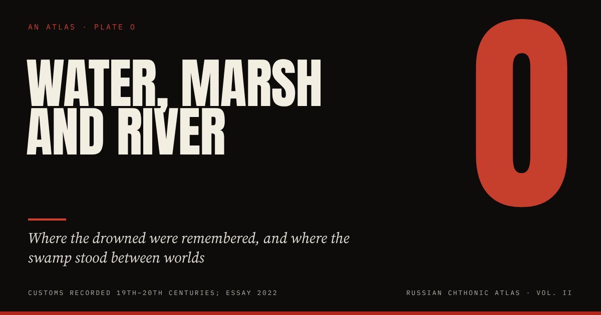
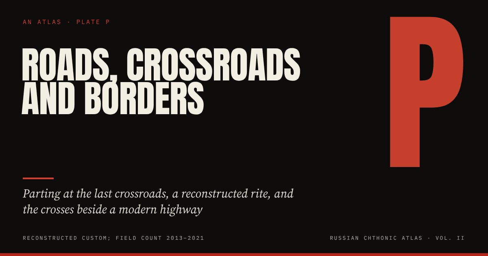
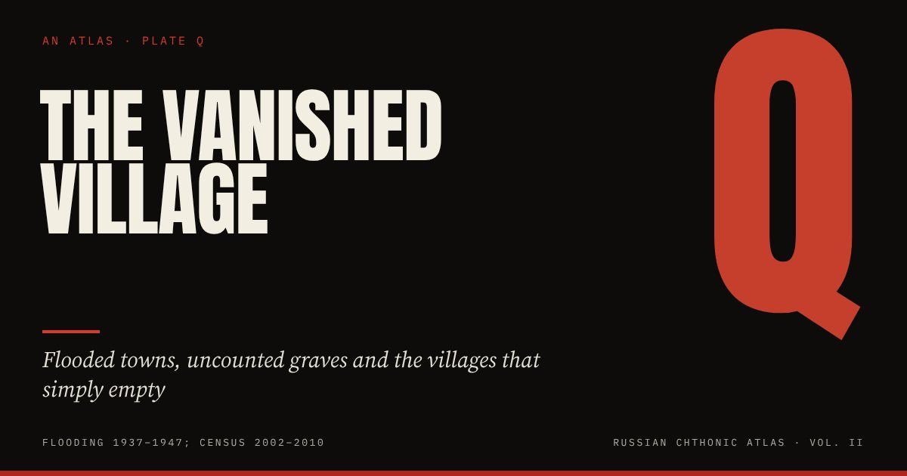
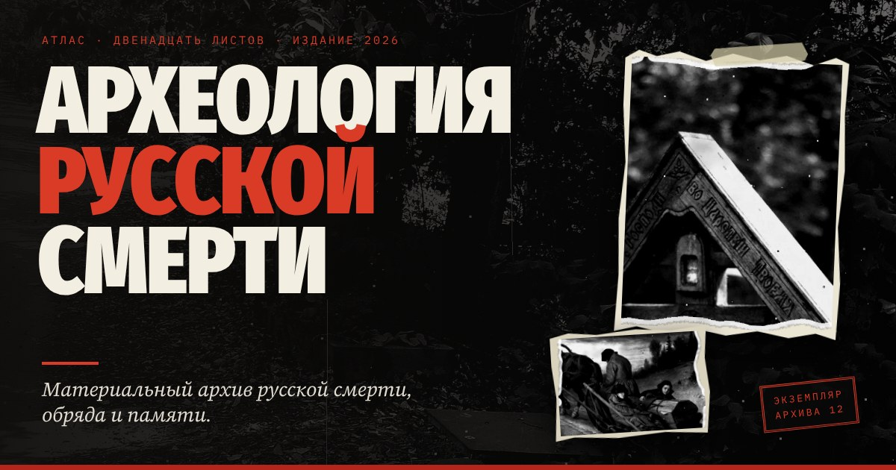

# RUSSIAN CHTHONIC ATLAS

*Volume I: ARCHÆOLOGY OF RUSSIAN DEATH*

<a href="https://DmitryLeLeE.github.io/rus_death/"></a>

**An atlas of death, memory, ritual and the afterlife in Russian culture.**
Nineteen plates in three volumes so far (Volume I complete, Volumes II and III begun), a map, a chronology, a lexicon and a bibliography, in English and Russian. The other plates of the atlas are listed on the [volumes page](https://DmitryLeLeE.github.io/rus_death/volumes.html) as research leads until their sources are checked.

**Read it:** <https://DmitryLeLeE.github.io/rus_death/> · **По-русски:** <https://DmitryLeLeE.github.io/rus_death/ru/>

---

## What this is

Not a themed landing page and not an encyclopaedia: an atlas of compositions on one problem, assembled to feel like an independent edition found, not made. Old cemetery photographs, icons, paintings, ethnographic records, torn paper, photocopies, margin notes.

One rule runs through every plate: **documented** facts are kept apart from **interpretation** and from **reconstruction**. No invented sources, quotations, archive numbers or historical photographs. Where the evidence stops, the sheet stays empty (plate L).

> Not Slavic fantasy. Not gothic horror. Not a dark aesthetic.
> The aesthetic is Russian death, remembered through matter.

## The plates

<table>
<tr><td width="33%"><a href="https://DmitryLeLeE.github.io/rus_death/plates/a-threshold.html"></a></td><td width="33%"><a href="https://DmitryLeLeE.github.io/rus_death/plates/b-body.html"></a></td><td width="33%"><a href="https://DmitryLeLeE.github.io/rus_death/plates/c-ritual.html"></a></td></tr>
<tr><td width="33%"><a href="https://DmitryLeLeE.github.io/rus_death/plates/d-table.html"></a></td><td width="33%"><a href="https://DmitryLeLeE.github.io/rus_death/plates/e-returning.html"></a></td><td width="33%"><a href="https://DmitryLeLeE.github.io/rus_death/plates/f-grave.html"></a></td></tr>
<tr><td width="33%"><a href="https://DmitryLeLeE.github.io/rus_death/plates/g-voice.html"></a></td><td width="33%"><a href="https://DmitryLeLeE.github.io/rus_death/plates/h-afterlife.html"></a></td><td width="33%"><a href="https://DmitryLeLeE.github.io/rus_death/plates/i-collective.html"></a></td></tr>
<tr><td width="33%"><a href="https://DmitryLeLeE.github.io/rus_death/plates/j-art.html"></a></td><td width="33%"><a href="https://DmitryLeLeE.github.io/rus_death/plates/k-soviet.html"></a></td><td width="33%"><a href="https://DmitryLeLeE.github.io/rus_death/plates/l-unfinished.html"></a></td></tr>
<tr><td width="33%"><a href="https://DmitryLeLeE.github.io/rus_death/plates/m-empty-house.html"></a></td><td width="33%"><a href="https://DmitryLeLeE.github.io/rus_death/plates/n-forest-edge.html"></a></td><td width="33%"><a href="https://DmitryLeLeE.github.io/rus_death/plates/o-water-marsh-river.html"></a></td></tr>
<tr><td width="33%"><a href="https://DmitryLeLeE.github.io/rus_death/plates/p-roads-crossroads.html"></a></td><td width="33%"><a href="https://DmitryLeLeE.github.io/rus_death/plates/q-vanished-village.html"></a></td><td width="33%"><a href="https://DmitryLeLeE.github.io/rus_death/plates/r-underground.html"></a></td></tr>
</table>

*Click a card to open the plate. Each plate has its own composition, material and ground.*

## Inside

| Page | What it is |
| --- | --- |
| Cover | The object: title, collage, plates |
| Prologue | What the atlas is, what it will not do, three ways in |
| Volumes | The four volumes: published plates and planned ones, marked as research leads |
| Plates A–Q | Research plates, each with its own composition (A–L Volume I, M–Q Volume II) |
| Index | Card catalogue of plates, objects, concepts and places |
| Map | Eight documented localities |
| Chronology | Points and caesuras, filterable by period |
| Words | Lexicon of the Russian terms the atlas uses |
| Sources | Bibliography with what each source can and cannot support; image credits |
| Method | Scope, evidence levels, periodisation, limits |

There is a *Readable* button in the header (calm paper, no tilt, larger type) and an optional *Sound* button (a quiet room, wind and a far bell, synthesised in the browser; off by default). Every motion effect switches off under `prefers-reduced-motion`, and each plate prints as a plain black-and-white sheet.

## По-русски

<a href="https://DmitryLeLeE.github.io/rus_death/ru/"></a>

«Археология русской смерти» — атлас смерти, памяти, обряда и загробного мира в русской культуре: девятнадцать листов, карта, хронология, словарь и библиография. Русское издание лежит в `/ru/` и содержит всё то же, что английское. Факты в нём отделены от интерпретации и реконструкции, выдуманных источников и цитат нет.

## Run and rebuild

The generated HTML is committed, so the site needs no toolchain. To look at it locally:

```bash
python -m http.server 8123      # then open http://127.0.0.1:8123/
```

To change content, edit the JSON in `data/` (Russian text lives in `data/ru/`) and re-render:

```bash
node build/build.mjs            # both languages, sitemap and robots.txt
node build/check_links.mjs      # every local link, anchor and asset
```

The image derivatives, textures, map and social cards have their own scripts in `build/` (`make_derived.py`, `make_assets.py`, `make_map.py`, `make_social.mjs`); they need Python with Pillow and NumPy, or Chrome for the social cards.

## Limits

The atlas states its gaps rather than filling them: no field survey, no municipal burial register, no systematic study of post-Soviet commercial funerals or digital memorials, and no verbatim laments, proverbs or epitaphs. The single Ukrainian photograph (plate D) is labelled as Ukrainian. See the Method page and the uncertainty notes in the plates.

## Licensing and credits

- Original text, data, diagrams, textures and code: **CC BY-SA 4.0**.
- Third-party images: public domain, CC0 or CC BY / CC BY-SA, each with its author, licence and a link to the original, listed in [`ASSET_CREDITS.md`](ASSET_CREDITS.md) and on the Sources page. The repository holds scaled-down copies of the Wikimedia Commons originals.
- Typefaces: SIL Open Font License 1.1 (Special Elite: Apache 2.0), licence texts in `assets/fonts/`.
- Map geometry: Natural Earth, public domain.
- Statement → source registry: [`SOURCES.md`](SOURCES.md).

No analytics, no cookies, no external requests. The only things stored in the browser are your language, *Readable* and *Sound* choices.
