# RUSSIAN CHTHONIC ATLAS

*Volume I: ARCHÆOLOGY OF RUSSIAN DEATH*

<a href="https://DmitryLeLeE.github.io/rus_death/"></a>

**An atlas of death, memory, ritual and the afterlife in Russian culture.**
Twenty-four plates (A–X) in four volumes, all published, with a map, a chronology, a lexicon, a bibliography, a claim ledger, reading routes and search, in English and Russian. Volume I (A–H, J) is the grave, the body and the table; II (M–R) the places where the living and the dead meet; III (S–V) the unseen; IV (I, K, L, W, X) mass death, the Soviet funeral, the archive, abandonment and the digital afterlife. The [volumes page](https://DmitryLeLeE.github.io/rus_death/volumes.html) lists them; nothing is shown there as planned content.

**Read it:** <https://DmitryLeLeE.github.io/rus_death/> · **По-русски:** <https://DmitryLeLeE.github.io/rus_death/ru/>

---

## What this is

Not a themed landing page and not an encyclopaedia: an atlas of compositions on one problem, assembled to feel like an independent edition found, not made. Old cemetery photographs, icons, paintings, ethnographic records, torn paper, photocopies, margin notes.

One rule runs through every plate: **documented** facts are kept apart from **interpretation** and from **reconstruction**, and what could not be verified is marked **unverified**. A section can also carry a **contested** flag where the sources disagree. No invented sources, quotations, archive numbers or historical photographs. Where the evidence stops, the sheet stays empty (plate L).

> Not Slavic fantasy. Not gothic horror. Not a dark aesthetic.
> The aesthetic is Russian death, remembered through matter.

## The plates

<table>
<tr><td width="33%"><a href="https://DmitryLeLeE.github.io/rus_death/plates/a-threshold.html">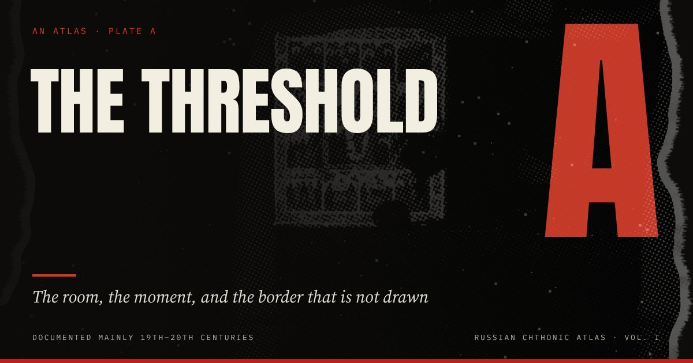</a></td><td width="33%"><a href="https://DmitryLeLeE.github.io/rus_death/plates/b-body.html">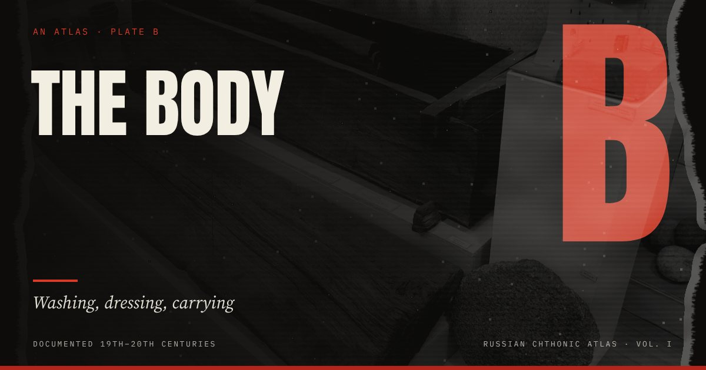</a></td><td width="33%"><a href="https://DmitryLeLeE.github.io/rus_death/plates/c-ritual.html"></a></td></tr>
<tr><td width="33%"><a href="https://DmitryLeLeE.github.io/rus_death/plates/d-table.html">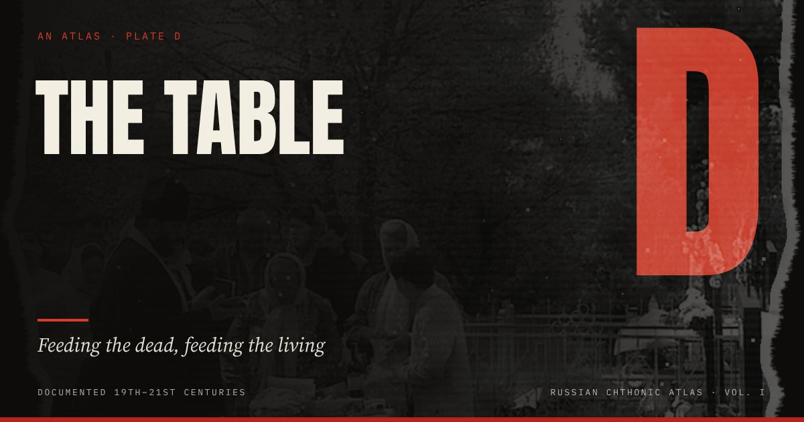</a></td><td width="33%"><a href="https://DmitryLeLeE.github.io/rus_death/plates/e-returning.html">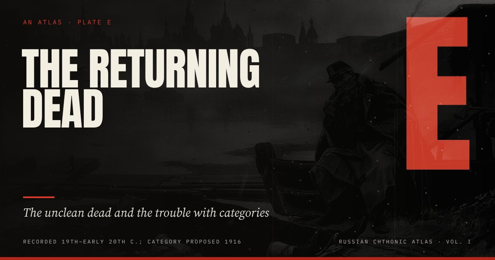</a></td><td width="33%"><a href="https://DmitryLeLeE.github.io/rus_death/plates/f-grave.html">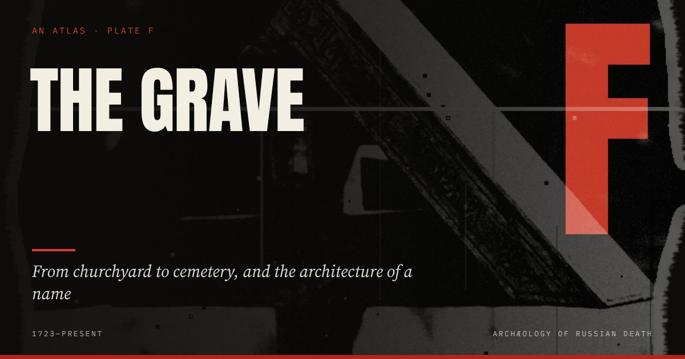</a></td></tr>
<tr><td width="33%"><a href="https://DmitryLeLeE.github.io/rus_death/plates/g-voice.html">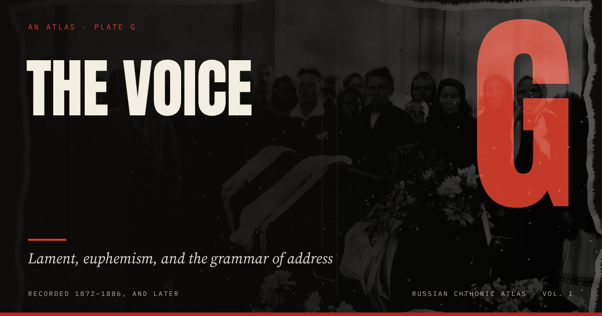</a></td><td width="33%"><a href="https://DmitryLeLeE.github.io/rus_death/plates/h-afterlife.html"></a></td><td width="33%"><a href="https://DmitryLeLeE.github.io/rus_death/plates/i-collective.html">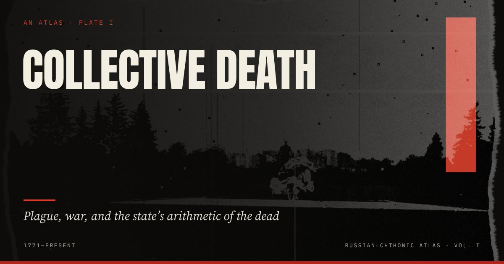</a></td></tr>
<tr><td width="33%"><a href="https://DmitryLeLeE.github.io/rus_death/plates/j-art.html">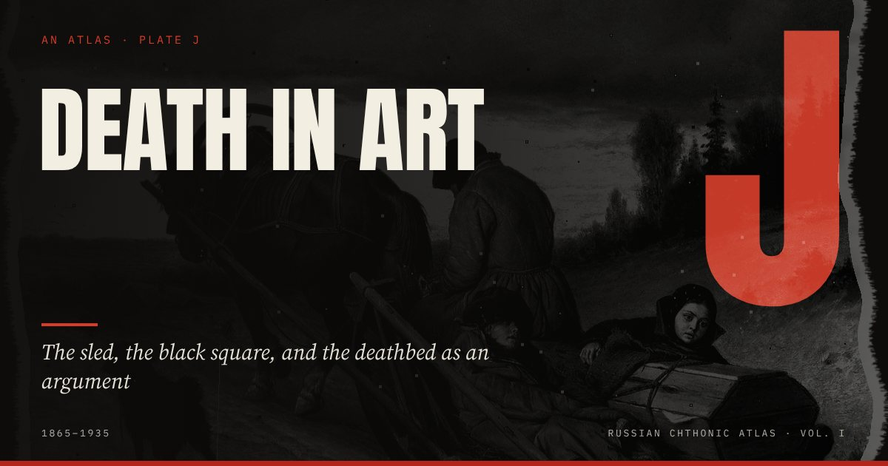</a></td><td width="33%"><a href="https://DmitryLeLeE.github.io/rus_death/plates/k-soviet.html"></a></td><td width="33%"><a href="https://DmitryLeLeE.github.io/rus_death/plates/l-unfinished.html"></a></td></tr>
<tr><td width="33%"><a href="https://DmitryLeLeE.github.io/rus_death/plates/m-empty-house.html"></a></td><td width="33%"><a href="https://DmitryLeLeE.github.io/rus_death/plates/n-forest-edge.html">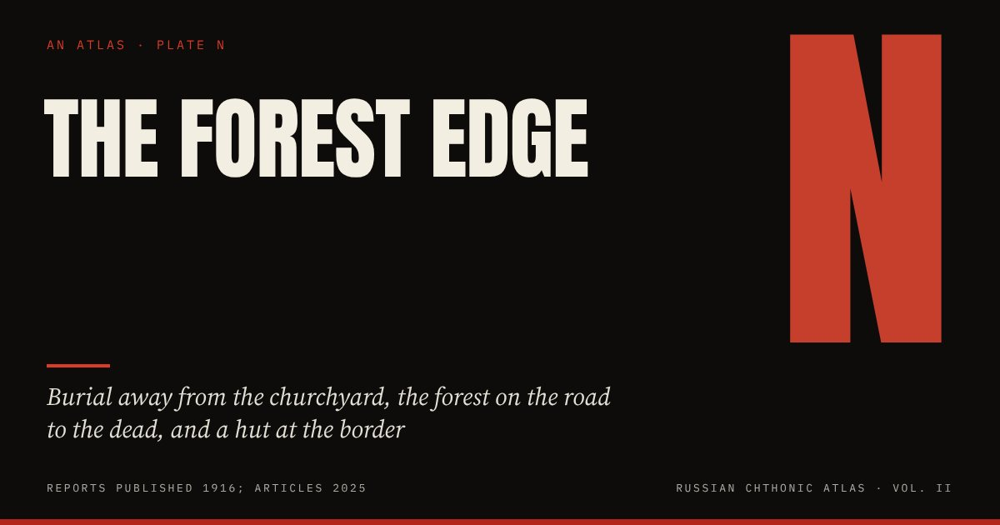</a></td><td width="33%"><a href="https://DmitryLeLeE.github.io/rus_death/plates/o-water-marsh-river.html"></a></td></tr>
<tr><td width="33%"><a href="https://DmitryLeLeE.github.io/rus_death/plates/p-roads-crossroads.html"></a></td><td width="33%"><a href="https://DmitryLeLeE.github.io/rus_death/plates/q-vanished-village.html"></a></td><td width="33%"><a href="https://DmitryLeLeE.github.io/rus_death/plates/r-underground.html">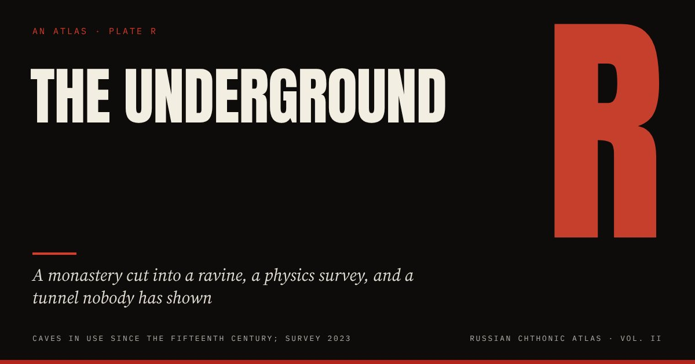</a></td></tr>
<tr><td width="33%"><a href="https://DmitryLeLeE.github.io/rus_death/plates/s-household-spirits.html">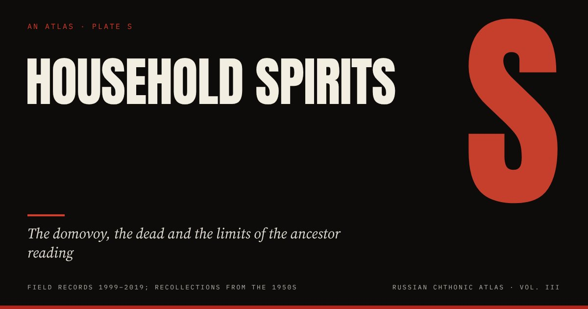</a></td><td width="33%"><a href="https://DmitryLeLeE.github.io/rus_death/plates/t-unquiet-dead.html">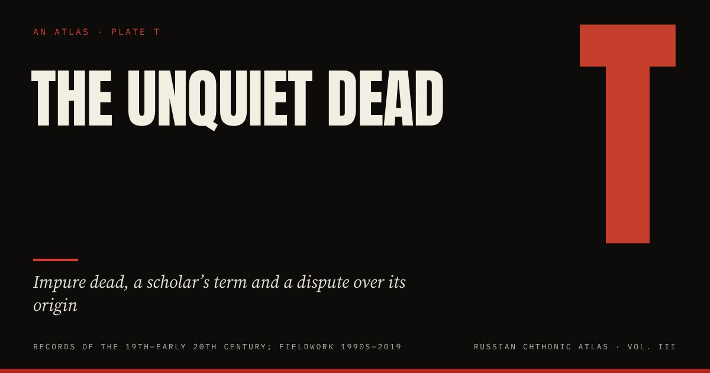</a></td><td width="33%"><a href="https://DmitryLeLeE.github.io/rus_death/plates/u-calendar-of-the-dead.html">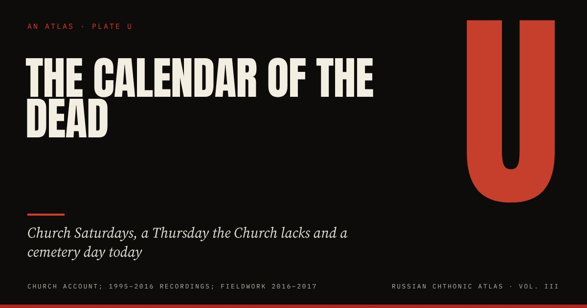</a></td></tr>
<tr><td width="33%"><a href="https://DmitryLeLeE.github.io/rus_death/plates/v-taboo-and-protection.html">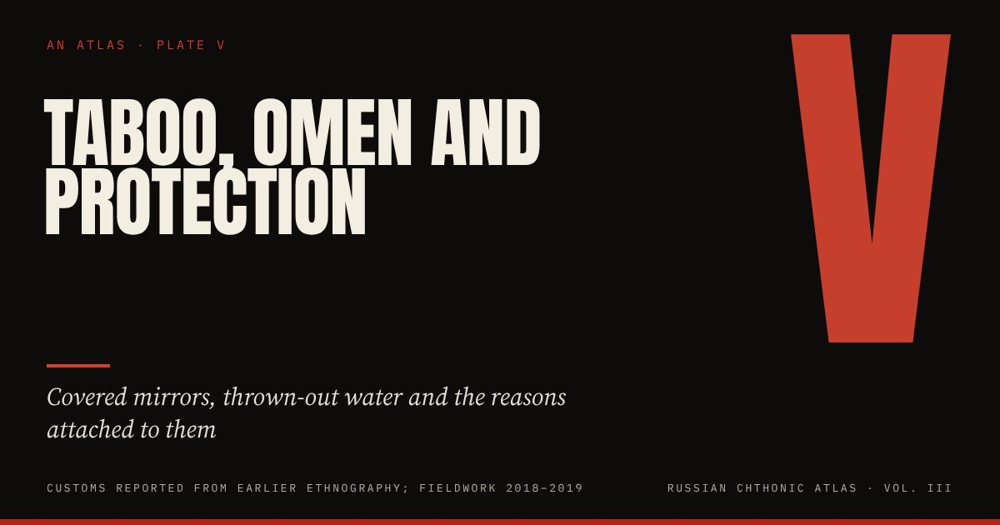</a></td><td width="33%"><a href="https://DmitryLeLeE.github.io/rus_death/plates/w-materials-of-abandonment.html">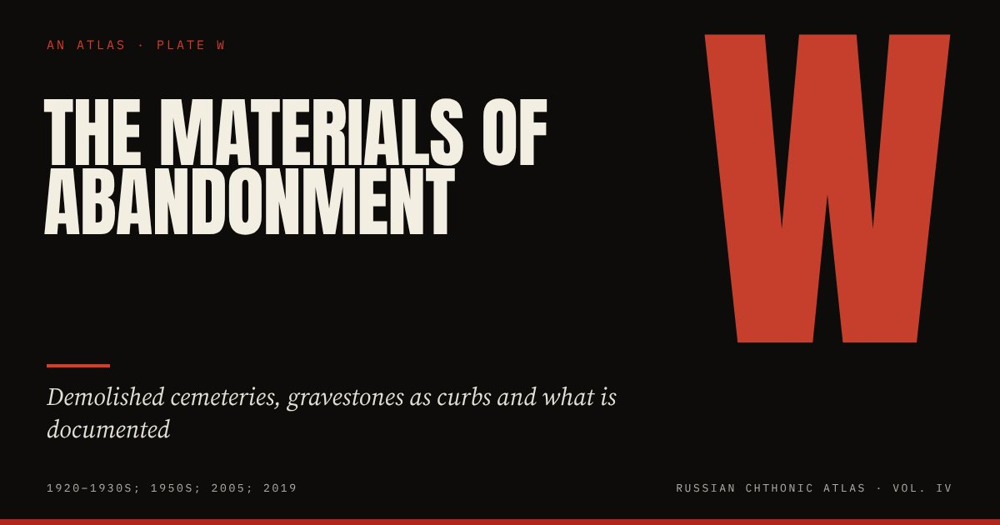</a></td><td width="33%"><a href="https://DmitryLeLeE.github.io/rus_death/plates/x-digital-afterlife.html">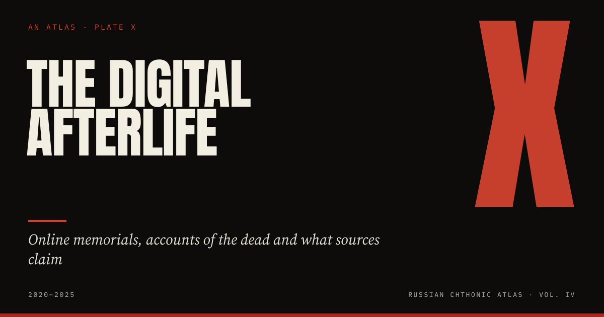</a></td></tr>
</table>

*Click a card to open the plate. Each plate has its own composition, material and ground.*

## Inside

| Page | What it is |
| --- | --- |
| Cover | The object: title, collage, plates |
| Prologue | What the atlas is, what it will not do, three ways in |
| Volumes | The four volumes and the plates in each |
| Plates A–X | Research plates, each with its own composition |
| Index | Card catalogue of plates, objects, concepts and places |
| Field archive | The catalogue of objects and what is known about each (28 entries) |
| Map | 36 localities, with what the sources say of each |
| Chronology | 37 points and caesuras, filterable by period |
| Words | Lexicon of the Russian terms the atlas uses (61 entries) |
| Reading routes | Seven paths through the plates, covering all 24 compositions |
| Claim ledger | Every section of every plate with its evidence level and sources, generated from the plate data |
| Search | Client-side search over the whole atlas, English and Russian |
| Sources | Bibliography with what each source can and cannot support; image credits |
| Method | Scope, evidence levels, periodisation, limits |
| Colophon | How the edition was made |

Pages change in place (`js/nav.js`), so the sound keeps running between pages; anything unusual falls back to an ordinary page load. There is a *Readable* button in the header (calm paper, no tilt, larger type) and an optional *Sound* button (a quiet room, wind and a far bell, synthesised in the browser; off by default). Every motion effect switches off under `prefers-reduced-motion`, and each plate prints as a plain black-and-white sheet.

## По-русски

<a href="https://DmitryLeLeE.github.io/rus_death/ru/"></a>

«Археология русской смерти» — атлас смерти, памяти, обряда и загробного мира в русской культуре: двадцать четыре листа в четырёх томах, карта, хронология, словарь, библиография, реестр утверждений, маршруты чтения и поиск. Русское издание лежит в `/ru/` и содержит всё то же, что английское. Факты в нём отделены от интерпретации и реконструкции, выдуманных источников и цитат нет.

## Run and rebuild

The generated HTML is committed, so the site needs no toolchain. To look at it locally:

```bash
python -m http.server 8123      # then open http://127.0.0.1:8123/
```

To change content, edit the JSON in `data/` (Russian text lives in `data/ru/`) and re-render:

```bash
node build/build.mjs            # both languages, sitemap and robots.txt
node build/validate.mjs         # plate data: levels, sources, RU parity
node build/check_links.mjs      # every local link, anchor and asset
node build/check_credits.mjs    # every image has a record, licence and evidence status
node build/make_credits.mjs     # regenerates ASSET_CREDITS.md
python build/make_visual_audit.py   # regenerates VISUAL_AUDIT.md
```

The image derivatives, textures, map, original diagrams and social cards have their own scripts in `build/` (`make_derived.py`, `make_assets.py`, `make_map.py`, `make_diagrams.py`, `make_diagrams2.py`, `make_social.mjs`); they need Python with Pillow and NumPy, or Chrome for the social cards.

## Images

`data/images.json` holds 171 records: 66 photographs, 9 paintings, 7 prints, 2 icons, 20 original diagram files (10 diagrams, each in English and Russian), and 65 derivatives (halftone, duotone, xerox) that point back to their originals. Every record has a licence and a role: archival, contextual, artwork reproduction or original diagram. Original diagrams are labelled as editorial diagrams and draw only what the plate's sourced text states. Photographs from outside Russia (for example the Estonian Old Believers' cemeteries on plate F, the Ukrainian photograph on plate D, the Pripyat engravings on plate O) are labelled as comparisons. `IMAGE_ACQUISITION_REPORT.md` records which archives were searched, which were blocked by bot protection (Library of Congress, Finna, the Estonian register: not bypassed) and which need written permission (the ethnographic museums).

## Working documents

| File | What it records |
| --- | --- |
| `SOURCES.md` | Statement → source registry |
| `FACTCHECK_LOG.md` | What was checked against independent sources, what was corrected, what was not checked |
| `IMAGE_ACQUISITION_REPORT.md` | Source-by-source image search and its outcome |
| `VISUAL_AUDIT.md` | Image counts per plate (generated) |
| `ASSET_CREDITS.md` | Author, licence and link for every image (generated) |

## Limits

The atlas states its gaps rather than filling them: no field survey, no municipal burial register, no systematic study of post-Soviet commercial funerals or digital memorials, and only a small number of public-domain laments, poems, songs, epitaphs and liturgical texts, printed from the cited editions and not as an anthology. Most sources were read through open-access texts, abstracts or summaries, not page by page, and each bibliography entry states what was and was not read. The fact-check pass covered the chronology, lexicon, object catalogue and routes against independent sources; it did not cover every plate sentence. What was not tested in a browser: keyboard use, the console, audio, Safari and iOS, and widths other than 1440 px for the pages checked. See the Method page and the uncertainty notes in the plates.

## Licensing and credits

- Original text, data, diagrams, textures and code: **CC BY-SA 4.0**.
- Third-party images: public domain, CC0 or CC BY / CC BY-SA, each with its author, licence and a link to the original, listed in [`ASSET_CREDITS.md`](ASSET_CREDITS.md) and on the Sources page. The repository holds scaled-down copies of the Wikimedia Commons originals.
- Typefaces: SIL Open Font License 1.1 (Special Elite: Apache 2.0), licence texts in `assets/fonts/`.
- Map geometry: Natural Earth, public domain.
- Statement → source registry: [`SOURCES.md`](SOURCES.md).

No analytics, no cookies, no external requests. The only things stored in the browser are your language, *Readable* and *Sound* choices.

## Images of the dead

A photograph of a deceased person is shown only behind an 18+ gate: it stays blurred, with the original view hidden, until the reader confirms. Without JavaScript it stays closed. The gate is set per image with `"mature": true` in `data/images.json` (a derived crop inherits it from its parent). Currently five images carry it: the carte-de-visite photograph of a dead man laid out for burial (plate B), the funerals of Tolstoy and of Chapaev’s brother and the Port Arthur burial (plate K) and Nansen’s sledge with a body (plate N). Remains are otherwise not shown.
